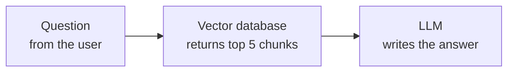
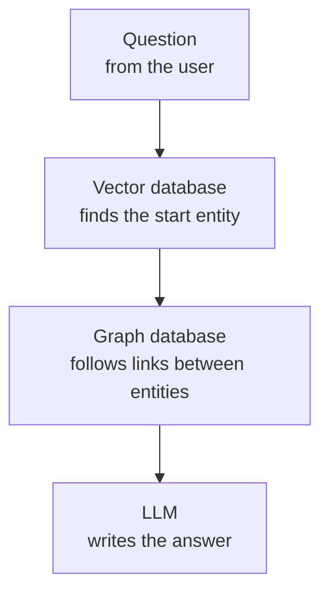
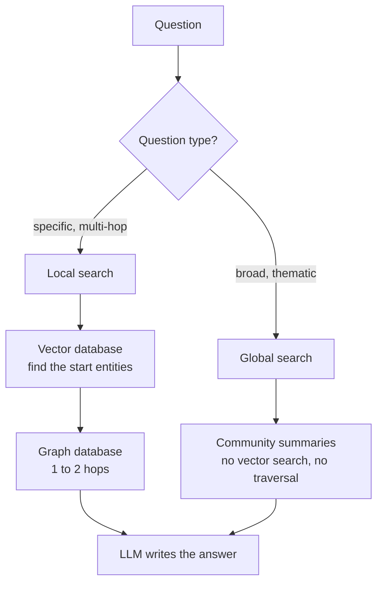

# RAG and GraphRAG

Reference notes for this project. Written in ASD-STE100 Simplified Technical English.

Main idea: RAG and GraphRAG both send documents to an LLM. They are different in
**how they find the documents**.

An LLM is a large language model, for example Claude.

---

## 1. What RAG does

RAG means retrieval-augmented generation. RAG works in four steps.

1. The program divides your documents into small parts. We call each part a chunk.
2. The program converts each chunk into a list of numbers. We call this list an
   embedding. The program puts the embeddings into a vector database.
3. For each question, the program converts the question into an embedding. Then the
   program finds the 5 chunks with the most similar embeddings.
4. The program sends the 5 chunks and the question to the LLM. The LLM writes the
   answer.

A vector database does one thing only. It finds text with a similar meaning.



---

## 2. The limit of RAG

RAG finds each chunk separately. RAG does not know that two chunks are about the
same person.

Example. Three documents hold these facts:

| Document | Fact |
|---|---|
| A | Maya led the Halcyon purchase. |
| B | Maya manages Project Atlas. |
| C | Project Atlas uses the Vertex platform. |

Now ask this question:

> Which platform does the project of the person who led the Halcyon purchase use?

The correct answer is Vertex. But you must use all three documents to find it.

RAG finds the 5 chunks most similar to the question. Document C is not similar to
the question, because document C does not mention Halcyon or Maya. So RAG often
misses document C. The LLM then gives a wrong answer, or no answer.

This problem has a name. We call it a multi-hop question.

---

## 3. What GraphRAG does

GraphRAG does extra work **before** you ask any question. This work has three steps.

1. An LLM reads each chunk. The LLM extracts the entities and the relations. An
   entity is a person, a project, a team, or a platform. A relation is a link
   between two entities, for example "Maya manages Project Atlas".
2. The program puts the entities and the relations into a graph database. The
   result is a knowledge graph.
3. The program divides the graph into groups of entities that connect to each
   other. We call each group a community. An LLM then writes a short summary of
   each community.

Now the program can answer the question in section 2. The program finds Maya in the
graph. Then the program follows the relations from Maya to Project Atlas, and from
Project Atlas to Vertex. Three documents, three hops, one answer.



---

## 4. Which database does GraphRAG use?

**GraphRAG uses both databases.** It does not replace the vector database with a
graph database. The two databases do different jobs:

- The vector database finds the entry point. You give it a question, and it finds
  the entities in the graph that match the question.
- The graph database does the hops. It starts at those entities and follows the
  relations.

This is the part people get wrong. A graph database cannot find an entity from a
question in plain English. A graph database matches names and patterns, not
meaning. So you still need embeddings and a vector database to get into the graph.

### How this project does it

Neo4j does both jobs. Neo4j has a native vector index, so Neo4j holds the entity
embeddings itself. Chroma holds the chunk embeddings for the baseline system only.

So "two databases" is correct as a description of the two **jobs**. It is not always
two separate servers. Some graph databases include a vector index. Neo4j is one of
them. Memgraph also has a vector index, but a simpler one.

---

## 5. The two retrieval methods

GraphRAG has two retrieval methods. They answer different question types.

**Local search** answers specific questions, for example multi-hop questions. Local
search uses the vector database and then the graph.

**Global search** answers broad questions, for example "What are the main causes of
delay across all projects?". Global search reads the community summaries. It does
not use the vector database, and it does not use the graph.

Global search has no equivalent in RAG at all. A top-k vector database cannot build
a summary of the whole corpus at query time. GraphRAG builds these summaries in
advance.



---

## 6. Which LLM extracts the entities?

**The LLM is fully configurable. The graph database does not control it.**

The two parts are independent:

- Neo4j is a database. It stores nodes and relations, and it answers queries in
  Cypher. Neo4j contains no LLM.
- Memgraph is also a database. Memgraph also contains no LLM.

Your code does the extraction. Your code reads a chunk, sends it to an LLM, receives
entities and relations, and writes them to the database with a Cypher query. The
database receives entities and relations. It never learns which LLM produced them.

In this project the LLM is one line in `src/graphrag_lab/config.py`:

```python
extract_model: str = "claude-haiku-5-5"
```

Change that line to `claude-opus-5-5`, or to a local model, and nothing else in the
project changes. You can also use one LLM for the extraction and a different LLM for
the answers. This project does exactly this. The extraction needs about 300 calls,
and Haiku costs about 40 times less than Opus.

### Why this is confusing

Two things cause the confusion:

- Microsoft's `graphrag` library uses a configuration file for the model. The model
  looks like a fixed setting of the library. It is not. It is a setting of the
  library, not of the database.
- Memgraph and Neo4j both market "GraphRAG support". This support is example code
  and integration libraries. It is not an LLM inside the database.

Memgraph is a graph database. It is not a GraphRAG solution. GraphRAG is a
retrieval pattern. You can build it on Neo4j, on Memgraph, on Kuzu, or on a plain
Python dictionary.

---

## 7. When does GraphRAG win?

GraphRAG does not beat RAG on average. It wins on some question types and loses on
cost and speed everywhere.

| Question type | Example | Which system wins |
|---|---|---|
| Local factual | "What is the objective of Project Atlas?" | RAG, or a tie. Graph context adds noise. |
| Multi-hop | The question in section 2 | GraphRAG |
| Global thematic | "What are the recurring causes of delay?" | GraphRAG. RAG cannot see the whole corpus. |
| Entity gather | "Tell me everything about Maya." | GraphRAG. Top-5 cannot reach 8 documents. |
| Set and count | "How many projects use Vertex, and which?" | GraphRAG |
| Absent information | A question about an event that never happened | Watch both. More context can increase invented answers. |

GraphRAG also costs much more. It needs about 300 LLM calls to build the graph, and
global search needs one LLM call for each community for each question. RAG needs one
LLM call for each question.

The correct conclusion is a trade-off. There is no single winner.

---

## Technical names used

RAG, GraphRAG, LLM, chunk, embedding, vector database, graph database, entity,
relation, knowledge graph, community, multi-hop question, local search, global
search, Neo4j, Memgraph, Kuzu, Chroma, Cypher, vector index, corpus, top-k, Claude,
Haiku, Opus.
